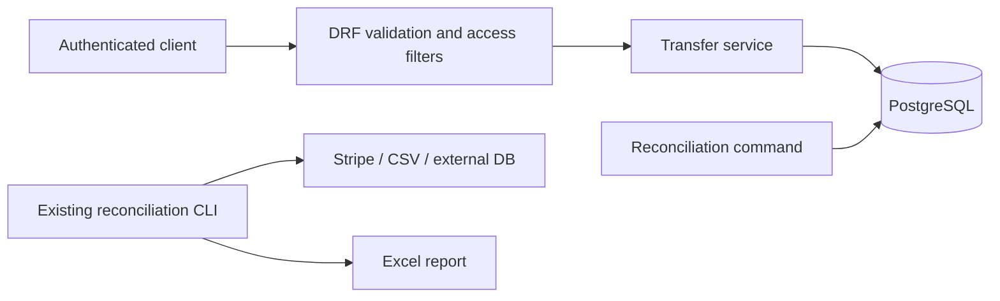

# Wallet architecture and correctness model

## System boundary

The wallet is a synchronous Django/DRF application backed by one PostgreSQL database. Its only transfer side effects are database writes. There are no provider calls, queues or distributed commits. The existing reconciliation CLI reads Stripe/CSV/SQLAlchemy sources and writes Excel reports; it does not automatically ingest wallet transfers.

| Responsibility | Source |
| --- | --- |
| Request shape, integer-only amounts, key syntax, read authorization | [api.py](../wallet_service/wallet/api.py) |
| Atomic write transaction, source ownership, lock order, business checks, replay | [services.py](../wallet_service/wallet/services.py) |
| Tables, foreign keys, uniqueness and row-level checks | [models.py](../wallet_service/wallet/models.py), [migration](../wallet_service/wallet/migrations/0001_initial.py) |
| Consistent audit snapshot and discrepancy classification | [reconciliation.py](../wallet_service/wallet/reconciliation.py) |
| Fixtures and repeatable demonstration | [management commands](../wallet_service/wallet/management/commands) |

The transfer service expects serializer-validated UUIDs and amounts. It is not a standalone validation boundary for arbitrary Python callers. New callers must preserve that precondition, transaction ordering and ownership checks.

## Data model

| Record | Meaning and relationships |
| --- | --- |
| `Account` | UUID, owner, GBP currency, opening balance and current balance |
| `Transfer` | UUID, requester, source/destination accounts, positive amount, final status and creation time |
| `LedgerEntry` | Signed amount linked to an account and transfer; negative for source, positive for destination |
| `IdempotencyRecord` | User/key, normalized request, original status/body, optional one-to-one transfer link |

A transfer has only two persisted states: `completed` and `rejected`. There is no committed `pending` state. A reservation is inserted within the same transaction as its result, so normal execution never exposes a committed incomplete reservation. `transfer` is nullable in the schema to permit that intermediate insert; completeness is a service invariant, not a database check.

Amounts are integer GBP minor units. Account opening/current balances are bounded inclusively at 0–10^12; transfer amounts at 1–10^12. Opening balances represent allocations outside the transfer ledger, so the complete database is not a general accounting system with issuance/liability accounts.

## Invariants and enforcement

| Invariant | Enforced by | Limit |
| --- | --- | --- |
| Current/opening balance stays within bounds; currency is GBP | Database CHECK constraints | Does not establish the provenance of a balance |
| Transfer amount is positive/bounded, accounts differ, status is final | Database CHECK constraints | Does not prove requester owns source |
| One reservation per user/key | Database UNIQUE constraint | Schema permits an incomplete record from a direct write |
| No duplicate account entry within a transfer; no zero entry | Database UNIQUE/CHECK constraints | Does not enforce exactly two entries or their sum |
| A completed transfer has entries `(source, -amount)` and `(destination, +amount)` | Transfer service; reconciliation detects disagreement | Direct writes can bypass the service |
| A rejected transfer has no entries | Transfer service; reconciliation | Not a cross-table database constraint |
| Current balance = opening balance + sum of account entries | Transfer service; reconciliation | Stored balances and ledger are both mutable by privileged writers |
| Requester owns source | Service under account locks; reconciliation compares stored requester with current owner | Ownership history is not recorded |
| Balances, transfer, entries and response appear together | One `transaction.atomic` boundary | Assumes the standard call is not restructured to commit pieces separately |

For an accepted amount `a`, source and destination change by `-a` and `+a`; their combined balance is conserved. The source check is performed while its row is locked. A database nonnegative-balance constraint is a second boundary, not the concurrency algorithm.

## Write transaction

1. Construct a canonical request from normalized UUIDs and integer amount.
2. Reserve `(user, key)` using `get_or_create`. A unique conflict waits for the competing insert to resolve. Under the configured/default PostgreSQL READ COMMITTED behaviour, the subsequent lookup can retrieve its committed response. A failed competing transaction leaves no reservation.
3. If the record already exists, compare the request. Return its status/body when equal; raise a 409 conflict otherwise. This path does not create a transfer or relock accounts.
4. For a new reservation, acquire both account locks with `select_for_update`, ordered by UUID. Verify both exist and the requester owns the source.
5. Check source funds and destination capacity using the locked values. Create either a rejected transfer, or a completed transfer plus balance changes and the debit/credit pair.
6. Store the original status/body and transfer link on the reservation. Exit the atomic block to commit. Only then does the view return.

No external I/O is performed while holding these locks. The reservation comes before account locks, so a duplicate request does not hold account locks while waiting on its key. Both transfers in an A→B/B→A race lock accounts in the same order; this avoids that specific inverted-order deadlock. It is not a guarantee that every future query or database interaction is deadlock-free. [PostgreSQL locking and deadlock guidance](https://www.postgresql.org/docs/16/explicit-locking.html) explains the underlying lock behaviour; [Django's queryset reference](https://docs.djangoproject.com/en/5.2/ref/models/querysets/#select-for-update) documents the transaction requirement and test caveats.

## Failure boundaries

| Failure point | Database outcome under normal transaction semantics | Recovery |
| --- | --- | --- |
| Invalid input before reservation | No new writes | Correct request |
| Account unavailable after reservation | Exception rolls back reservation | Correct references/access |
| Insufficient funds or destination full | Rejected transfer and original 409 commit; balances unchanged | Replay to recover result, or use a new key for a new attempt |
| Exception after debit, credit or entries but before commit | All writes in the transaction roll back | Retry unchanged request/key |
| Database connection drops around commit | Client may not know whether commit occurred | Retry unchanged request/key; stored response resolves a completed commit |
| Commit succeeds but response is lost | Transfer and response remain committed | Same-key replay returns original result |
| Database lock/statement timeout or deadlock abort | Transaction fails; no deliberate partial commit | Same-key retry with bounded backoff; server has no automatic retry loop |

Database settings request a 10-second lock timeout and 20-second statement timeout. These are database wait/statement controls, not an end-to-end HTTP deadline or latency objective. The API currently lets infrastructure exceptions propagate rather than mapping them to a dedicated error code.

Idempotency is scoped to one retained key record. It does not deduplicate different keys, different users or outside payment systems. Changing isolation level, key retention or wrapping calls in a larger transaction requires reviewing these assumptions. Existing replay also assumes account ownership is stable; there is no ownership-transfer API, and a future one needs explicit replay authorization semantics.

## Reconciliation

`reconcile()` opens a PostgreSQL repeatable-read, read-only transaction before querying. This gives its entry, transfer and account reads a common snapshot, preventing a legitimate commit between queries from appearing as a half-transfer. Invoke it as the standalone command/function; nesting it after queries in an existing transaction is unsupported because it sets transaction characteristics at entry.

It reports:

| Type | Evidence |
| --- | --- |
| `transfer_entries` | Transfer's actual account/amount pairs differ from the expected pair, or a rejected transfer has entries |
| `transfer_owner` | Stored requester differs from the source's current owner |
| `account_balance` | Recomputed balance differs from stored balance; includes expected, actual and related transfer IDs |

The command reads only; it never repairs. Related transfers narrow investigation but do not identify the root cause by themselves. The checker does not validate idempotency response completeness, compare external settlements, reconstruct ownership history or prove that coordinated edits to balances and ledger never occurred. It loads entries into memory, performs additional owner lookups, and scans entries for affected accounts; larger datasets need bounded queries and a batching design that preserves snapshot consistency.

## Operational boundary

There are no immutable-ledger triggers, restricted database writer roles, rate limits, token expiry, request correlation IDs, application metrics, backup/restore procedure or deployment manifests. Existing CLI JSON logging does not imply the wallet has structured operational telemetry. These omissions limit production use; prioritized follow-ups are recorded in the [decision record](decisions/0001-wallet-transfers.md).
